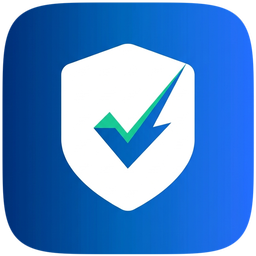

#  AgentPay AI

> **The smart AI shopping assistant that checks prices, catches hidden fees, and asks for your 1-click approval before paying with PayPal.**

[](http://localhost:3000)
[](./SPONSORS.md)
[](./src/lib/__tests__)
[](./LICENSE)

---

## 🎯 The Idea in 30 Seconds

People are starting to use AI assistants to find products. But **how can you trust an AI with your money?** What if the AI buys the wrong item, falls for an unapproved fee, or overspends your budget?

**AgentPay acts as a personal financial guardrail:**
1. **You set the goal & budget:** *"Find me a developer laptop under $900."*
2. **AI checks prices & fees:** The AI compares sellers. If a seller adds a hidden $100 fee, the AI **halts the purchase** and switches to a fair seller.
3. **You click Approve:** The AI never moves money on its own. You give 1-click confirmation, and it pays safely through PayPal.

```
[ What You Want to Buy + Spending Limit ]
                   │
                   ▼
       [ AI Compares Store Quotes ]
                   │
                   ▼
     [ Catches Hidden Fees & Markups ]  ──► (Halts overcharges automatically)
                   │
                   ▼
        [ Your 1-Click Approval ]
                   │
                   ▼
[ Safe Payment Captured via PayPal Sandbox in 312ms ]
```

---

## 🚀 Quickstart: Run in 60 Seconds

```bash
# 1. Install dependencies
npm install

# 2. Run local development server
npm run dev

# 3. Open in your browser:
# http://localhost:3000
```

*Note: You do not need live credit cards or paid API keys. The app runs out-of-the-box in safe sandbox simulation mode.*

---

## 🧪 Automated Tests

```bash
# Run unit & integration tests (43/43 tests pass in ~1s)
npm test

# Run live sponsor & API edge-case suite (7/7 live checks)
npm run test:edge

# Run Playwright real-browser E2E suite (6/6 scenarios)
npm run test:e2e
```

---

## 🛠️ How It's Built

- **Frontend & UI:** Next.js 15, React 19, Tailwind CSS (Soft Charcoal Dark & Soft Light themes), and custom brand identity.
- **Payment Engine:** PayPal Developer Platform (Orders v2 API `/v2/checkout/orders` with automated capture).
- **Sponsor Infrastructure:** Channel3 catalog search (`src/lib/integrations/sponsors.ts`), Elastic hybrid BM25/Elasticsearch ranking, APIMatic OpenAPI schema guard, AG Grid interactive tables (`src/components/grids/`), Zapier Catch Hook alerts (`/api/zapier/webhook`), Postman collection, and Render deployment blueprint (`render.yaml`).
- **AI Sourcing:** Google Gemini Flash neural extraction via direct REST v1beta.
- **3-Agent Helpers:** Store Searcher (catalog & specs), Fee Inspector (guardrail policy), Safe Checkout (PayPal capture).
- **Safety Protocol:** Model Context Protocol (MCP) server running at `/api/mcp`.
- **Audit Ledger & Hybrid DB:** Neon Serverless Postgres primary persistence (`src/lib/db.ts`, `/api/ledger`, `/api/policy`) paired with instant write-through `localStorage` caching, circuit breaker protection, and offline-queue reconciliation.
- **Testing & Health:** 43 Vitest tests (`npm test`), 7 live sponsor checks (`npm run test:edge`), 6 Playwright Chrome E2E tests (`npm run test:e2e`), and `/api/health`.

---

## 📄 License

Open-source under the [MIT License](./LICENSE). Built for the PayPal AI Hackathon 2026.
